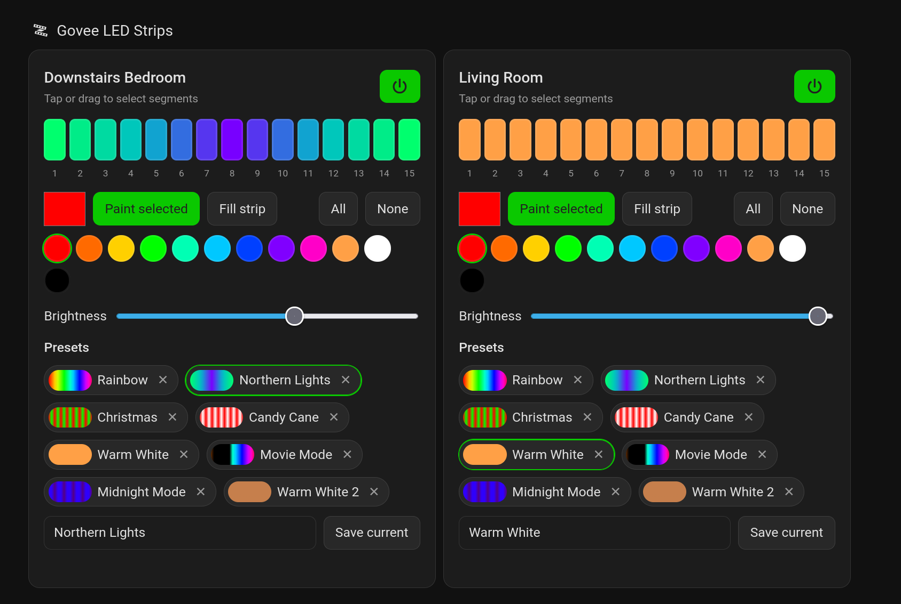

# Govee BLE Lighting Integration for HomeAssistant


A powerful and seamless integration to control your Govee lighting devices via Govee API or BLE directly from HomeAssistant with full features support.

---

## Table of Contents

- [Features](#features)
- [Installation](#installation)
- [Configuration](#configuration)
- [Usage](#usage)
- [Support & Contribution](#support--contribution)
- [License](#license)

---

## Features

- 🚀 **Direct BLE Control**: No need for middlewares or bridges. Connect and control your Govee devices directly through Bluetooth Low Energy.

- ☁️ **API Control**: Supported all light devices with full features support including scenes!

- 🌈 **Scene Selection**: Leverage the full potential of your Govee lights by choosing from all available scenes, transforming the ambiance of your room instantly.
  
- 💡 **Comprehensive Lighting Control**: Adjust brightness, change colors, or switch on/off with ease.

---

## Configuration

### What is needed

For Direct BLE Control:
- Before you begin, make certain HomeAssistant can access BLE on your platform. Ensure your HomeAssistant instance is granted permissions to utilize the Bluetooth Low Energy of your host machine.

For Govee API Control:
- Retrieve Govee-API-Key as described [here](https://developer.govee.com/reference/apply-you-govee-api-key), setup integration with API type ad fill your API key.

## Usage

With the integration setup, your Govee devices will appear as entities within HomeAssistant. All you need to do is select your device model when adding it.

---

## Troubleshooting for BLE

If you're facing issues with the integration, consider the following steps:

1. **Check BLE Connection**: 
   
   Ensure that the Govee device is within the Bluetooth range of your HomeAssistant host machine.

2. **Model Check**:

   Check that you selected correct device model.

3. **Logs**:

   HomeAssistant logs can provide insights into any issues. Navigate to `Configuration > Logs` to review any error messages related to the Govee integration.

---

## Support & Contribution

- **Found an Issue?** 
   
   Raise it in the [Issues section](https://github.com/Beshelmek/govee_ble_lights/issues) of this repository.

- **Device support**:

   Almost every Govee device has its own BLE message protocol. If you have an Android smartphone and your device is not supported, please contact me on [Telegram](https://t.me/Beshelmek).

- **Contributions**:

   We welcome community contributions! If you'd like to improve the integration or add new features, please fork the repository and submit a pull request.

---

## Future Plans

We aim to continuously improve this integration by:

- Supporting more Govee device models for BLE
- Enhancing the overall user experience and stability

---

## License

This project is under the MIT License. For full license details, please refer to the [LICENSE file](https://github.com/Beshelmek/govee_ble_lights/blob/main/LICENSE) in this repository.

## Segment control (fork additions)

For segmented BLE models (`SEGMENTED_MODELS` in `const.py`, including H617F/H617C), each strip gets:

- **15 segment lights** (`light.<device>_segment_1` … `_15`) with color and brightness, usable in scenes and automations.
- **A preset selector** (`select.<device>_preset`).
- **Actions** under `govee_ble_lights.*`: `set_segment_color`, `set_segments`, `apply_preset`, `save_preset`, `delete_preset`. Target the main strip light by `entity_id`.
- **A dashboard card**, loaded automatically:

```yaml
type: custom:govee-segment-card
entity: light.govee_light_2
name: Bedroom strip   # optional
```



Presets are stored in `.storage/govee_ble_lights.presets` and shared by all strips.